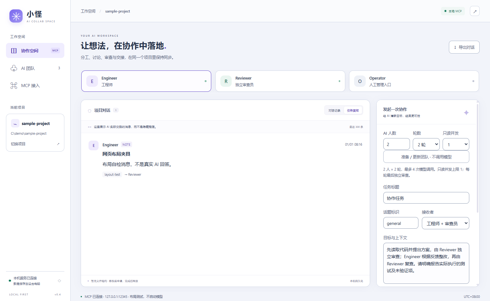

# 小怪 AI 协作中心

Windows 上的多 AI 协作工作台，通过 MCP 让多个参与者在同一个项目中分工、交流和审查代码。

界面使用 HTML/CSS/JS + WebView2，原生窗口由 C++/MFC 承载，后端使用 Python 和 SQLite。

## 功能

- 支持 2～50 个 AI 身份，按项目保存成员、分工和对话。
- 支持 1～3 轮协作，只读任务最多 4 路并发。
- Engineer 负责整合和修改，Reviewer 在每轮结束后独立审查；其他成员侧重测试、架构、风险和文档。
- 默认只读。开启写权限后，只有 Engineer 可修改代码，整轮串行执行。
- 支持定向消息、独立收件箱、消息确认、历史导出和文件租约。
- 提供管理 MCP，可直接操作工作台中的项目、参数、成员和任务。



*界面预览，使用示例数据。*

## 构建

环境要求：

- Windows x64、Python 3.13
- Visual Studio 2022，安装桌面 C++、MFC 和 Windows SDK
- WebView2 Runtime

```powershell
git clone https://github.com/SunXAbc/xiaoguai-ai-collab.git
cd xiaoguai-ai-collab
powershell -NoProfile -ExecutionPolicy Bypass -File .\scripts\build.ps1
```

脚本会安装依赖、恢复 WebView2 SDK、编译并运行测试，程序输出到 `bin/`。

已安装依赖时可加 `-SkipInstall`；需要桌面快捷方式时加 `-CreateDesktopShortcut`。重新构建前先关闭本目录下正在运行的程序。

## 使用

运行 AI 任务需要先安装并登录 Codex CLI。

1. 打开 `bin/XiaoguaiCollab.exe`，选择项目目录，也可以先试用 `sample-project`。
2. 设置人数、轮数和并发数，点击“准备 / 更新团队”。
3. 填写任务目标，根据需要开启工程师写权限，然后启动协作。
4. 在对话记录中查看各成员的结果；需要中断时点击“停止”。

内置执行器使用 Codex CLI 的独立上下文，每个参与者有自己的 MCP 身份。启动任务会使用模型额度，界面会显示本次最多调用次数。

模板成员为 Engineer、Reviewer 和 Agent03～Agent50。减少人数会保留已有成员及历史；手工登记的外部身份可通过各自的 MCP 客户端参与项目。

## MCP 接入

在“MCP 接入”中选择身份并导出配置，将 `mcpServers` 条目合并到对应客户端。每个参与者使用独立身份，工作台需要保持运行。

整窗控制使用单独的 `xiaoguai_ui` 配置，与项目消息身份分开。

| 工具 | 用途 |
|---|---|
| `collab_whoami` | 查询当前项目和身份 |
| `collab_members` | 查看成员、分工和文件租约 |
| `collab_send` | 定向发送消息 |
| `collab_inbox` | 读取本人收件箱 |
| `collab_thread` | 查看话题历史 |
| `collab_ack` | 确认消息 |
| `collab_reserve` | 申请或释放文件租约 |

详细说明：[协作协议](PROTOCOL.md) · [管理 MCP](UI_CONTROL_MCP.md) · [架构](ARCHITECTURE.md)

## 测试

```powershell
.\.venv\Scripts\python.exe -m pytest tests -q
.\.venv\Scripts\python.exe -m ruff check backend main.py tests scripts
```

## 许可证

[MIT](LICENSE)
